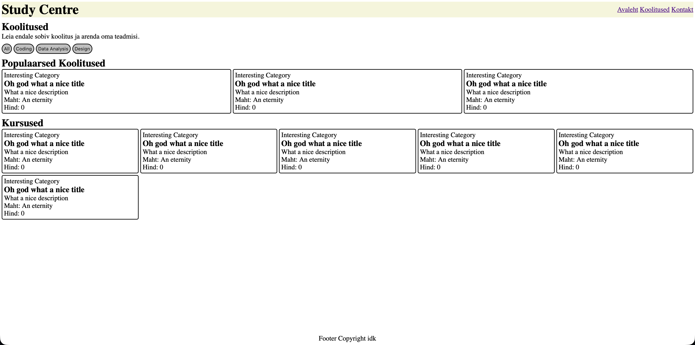

# ReactProject
A simple smth smth

## Kolm Struktuuri
```
Komponentide Hierarhia
1. App
2.
App
├── Header
│   └── Navgiation
├── Main
│   ├── Hero
│   ├── PillBoxView
│   │   └── PillBox
│   └── ItemCards
│       └── Card
└── Footer
3.
App
├── Header
├── Footer
└── Main
    ├── Hero
    ├── Pillboxes
    └── Cards
1.Millist lahendust on kõige lihtsam mõista? Kõiki.
2.Kui lihtne on muuta ainult koolituste kuvamise osa? Oleneb mida muuta.
3.Millises lahenduses tekib kõige tõenäolisemalt korduv kood? nr.1
4.Milliseid komponente saaks kasutada ka rakenduse teistes osades? header, footer, boxcardcollection.
5.Mis probleemid võivad tekkida liiga paljude väikeste komponentide kasutamisel? kohutavalt kaustasid ja faile.
6.Millise lahenduse valiksid edasiseks arendamiseks ja miks? nr3/2 hübriid.

Lehe Struktuur:
App
├── Header
├── Div(Hero laadne asi)
├── PillBoxes
├── Populaarne
│   └── (BoxCardCollection)
│       └── (BoxCard)
├── Kursused
│   └── (BoxCardCollection)
│       └── (BoxCard)
└── Footer	
```

